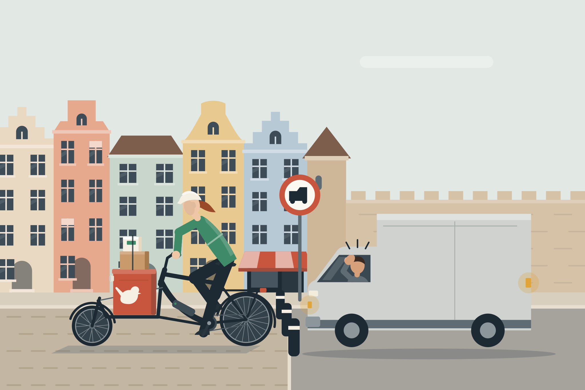

<Media>

</Media>

<Notes>
`image` with `text: none` and `transition: zoom`; use the picture alone when the room should look, not read.
Say nothing for a moment. The van stops at the bollards; the bike rides on into the Old Town. That is the whole talk in one picture.
</Notes>
