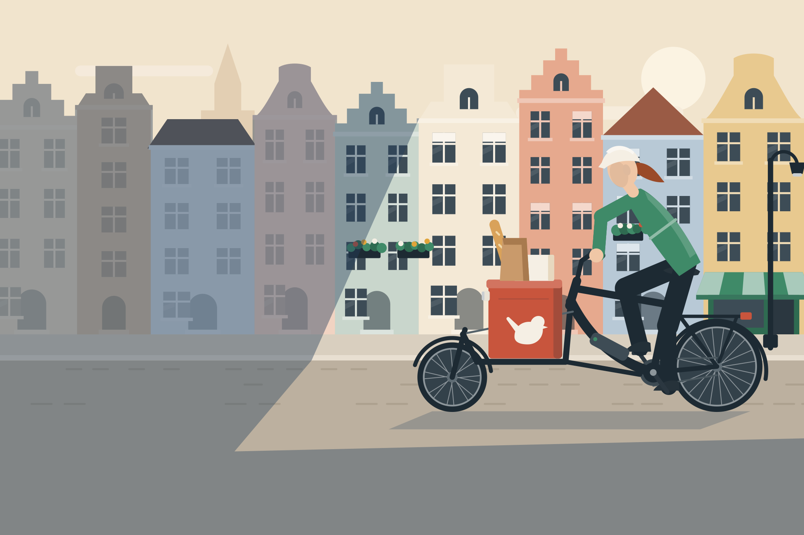

A van made 5.1 here, before the Old Town closed to it.

<Media>

</Media>

<Caption>Aoife on loop 14, Kestwick Old Town, 08:55.</Caption>

<Notes>
`image` with `text: bottom` (the default), `focal: center` and a `<Caption>`, the text on the shaded road along the bottom; use it when one picture makes the point and needs one line under its title.
This is Aoife on loop 14 this morning, the Brightloaf loaf on her box. In streets like this a rider stops at 9.4 doors an hour. A van managed 5.1, when it was still allowed in; we asked 112 merchants.
</Notes>
