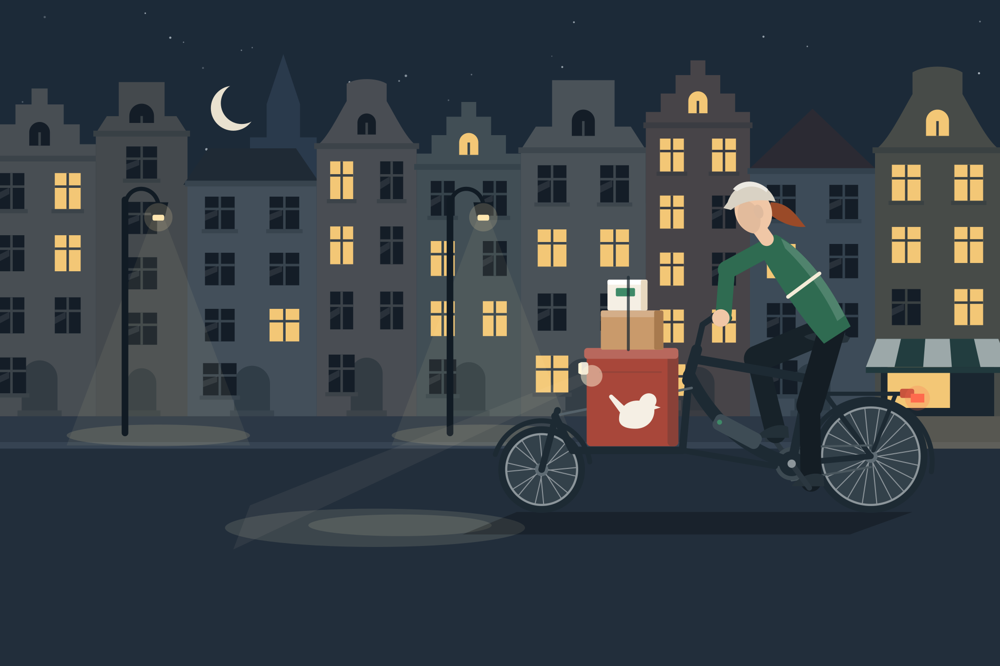

Six to nine: flowers and meal kits for people home from work.

<Media>

</Media>

<Caption>Kestwick Old Town, 7:40 pm.</Caption>

<Notes>
`image` with `text: left` and `focal: center`, which keeps the rider on the right and leaves the dark sky and facades behind the text; use it when the words belong beside the subject, not under it.
Not everyone is in at lunchtime. The evening window runs from six to nine, so flowers and meal kits arrive when people are home: Fennick Florists is its biggest user, and Okra Kitchen's meal kits ride in it too.
</Notes>
