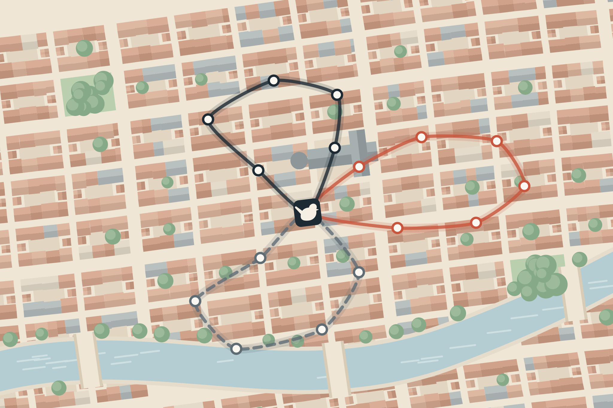

Narrow lanes that block vans are the shortest straight lines for a cargo bike.

<Media>

</Media>

<Notes>
`image-reveal` with `dock: top` and `barSurface: gradient`, carrying the cover's gradient treatment into the docked header bar.
</Notes>
