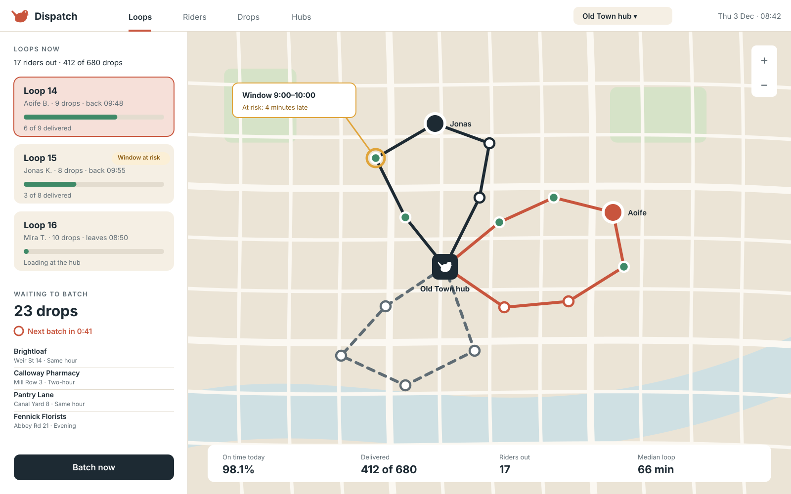

Riders, windows and active parcels stay visible in one uncropped view.

<Media>

</Media>

<Notes>
`image-reveal` with `dock: top`, `align: center`, `barSurface: inverse` and `fit: contain`, keeping the full product screen uncropped beneath the header bar.
</Notes>
