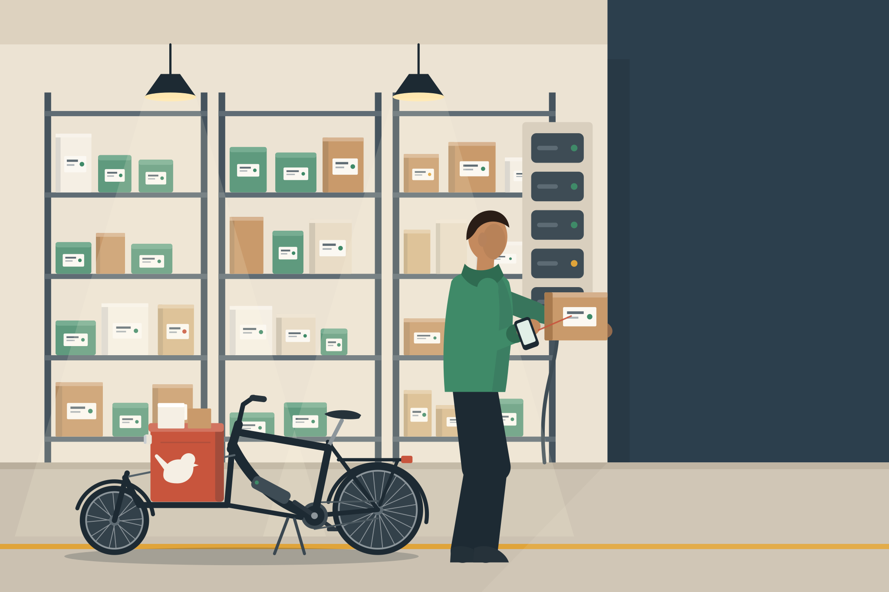

Scanned in the order of the doors, so a handover takes seconds.

<Media>

</Media>

<Notes>
`image` with `text: right` and `focal: center`, the text on the hub's dark wall; use it when the picture's calm side is on the right.
Before a loop leaves, every parcel is scanned into a numbered slot in the box, in the order of the doors. The loaf for Weir Street goes into B3, so at the door nobody unpacks the box on the pavement.
</Notes>
