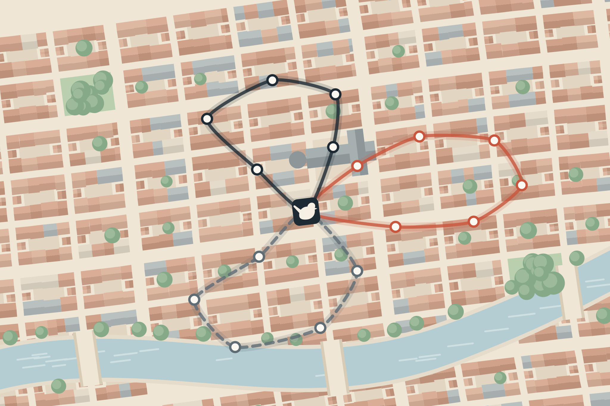

Any shop, platform or parcel carrier can book a Wrenhaul drop through one API.

<Media>

</Media>

<Notes>
`title` with `picture: full` and `transition: fade`; use it when the picture is calm all over or in its lower left, so the text can sit on the scrim.
This is the Old Town from above, with three of this morning's loops going out from one hub. From today any shop, platform or parcel carrier books a drop onto loops like these with one API call.
</Notes>
