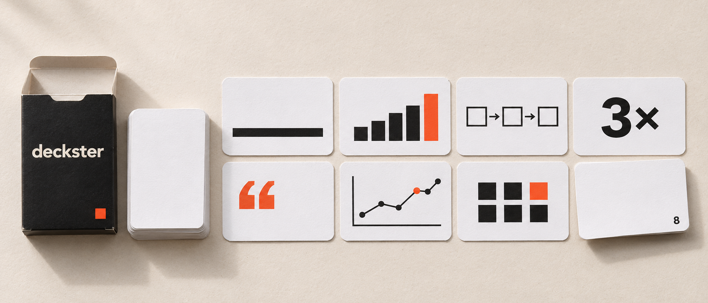

<p align="center">
  
</p>

<h1 align="center">@deckster/cli</h1>

<p align="center">
  The <code>deck</code> CLI for <strong>deckster</strong> — code-first MDX/TSX slides with typed layouts, brands, visual linting, PDF/PPTX export, and an Electron presenter.
</p>

<p align="center">
  <a href="https://www.npmjs.com/package/@deckster/cli"></a>
  <a href="https://github.com/sandrinodm/deckster/actions/workflows/ci.yml"></a>
  <a href="https://github.com/sandrinodm/deckster/blob/main/package.json">= 26" /></a>
  <a href="https://github.com/sandrinodm/deckster/blob/main/LICENSE"></a>
</p>

<p align="center">
  <a href="https://sandrinodm.github.io/deckster/"><strong>Documentation</strong></a> ·
  <a href="https://sandrinodm.github.io/deckster/get-started/quickstart/">Quickstart</a> ·
  <a href="https://sandrinodm.github.io/deckster/reference/cli/">CLI reference</a>
</p>

<p align="center">
  
</p>

---

## Install

Requires **Node.js 26 or later**:

```sh
npm install --global @deckster/cli
```

(`pnpm add --global @deckster/cli` works too.)

## Quick start

```sh
mkdir talks && cd talks
deck new launch-review --title "Launch review" --duration 20m
deck new slide launch-review results --layout stats
deck dev launch-review                    # hot-reload dev server (q or Ctrl+C to stop)
```

Check, screenshot, and export:

```sh
deck lint launch-review                   # checks schema, overflow, contrast, budgets, notes
deck shot launch-review results           # 1920x1080 PNG -> .deck/shots/launch-review/02-results.png
deck export launch-review                 # PDF + editable PPTX -> .deck/exports/launch-review/
deck types                                # optional: generate tsconfig.json for editor IntelliSense
```

A deck is just a plain folder (`decks/<name>/`) with `deck.config.ts` and `slides/*.mdx` (or `.tsx`) — no `package.json` or `node_modules` needed inside your talks folder.

## Highlights

- **MDX & TSX slides**: Write declarative slides with `<Step at={n}>` reveals and `<Notes>` speaker notes, or drop into TSX for interactive React demos.
- **Typed layouts & brands**: 32 built-in layouts and data-driven `brand.ts` themes (`--brand <name>`). Slides stay free of raw colors and pixel positioning.
- **Visual linting (`deck lint`)**: Renders every step of every slide in headless Chromium to catch overflow, truncated text, contrast failures (including over photos), off-brand values, and pacing issues.
- **PDF & editable PPTX export**: Vector PDFs with bookmarks and embedded fonts, plus hybrid/native PowerPoint decks with masters, editable text, native charts/diagrams, notes, and step animations.
- **Visual diffing (`deck diff`)**: Pixel-by-pixel slide comparison against a git ref or saved baseline, with an HTML report and PR summary.
- **Built for AI agents**: Every command supports `--json`, exposes typed catalogs (`layouts`, `charts`, `diagrams`, `components`, `icons`), and supports `--mcp` and `--agent claude|codex` in `deck dev`.

## Commands

Run `deck --help` for all commands, or `deck <command> --help` for full flags.

| Command                                  | Description                                                               |
| ---------------------------------------- | ------------------------------------------------------------------------- |
| `deck dev [deck]`                        | Serve a deck with hot reload (`--mcp`, `--agent claude\|codex`, `--host`) |
| `deck present [deck]`                    | Open in Electron with presenter notes, timer, and display selection       |
| `deck build [deck]`                      | Build static site output to `decks/<deck>/dist` (`--all`, `--out <dir>`)  |
| `deck preview [deck]`                    | Serve a built deck locally                                                |
| `deck new <deck>`                        | Scaffold a new deck (`deck new slide ...`, `deck new app ...`)            |
| `deck lint <deck>`                       | Validate schema, layout budgets, contrast, and overflow in Chromium       |
| `deck shot <deck> [slide]`               | Capture 1920x1080 PNGs (`--steps`, `--scale <n>`)                         |
| `deck diff <deck>`                       | Compare rendered slides against a git ref or `--save-baseline`            |
| `deck export <deck>`                     | Export `--pdf`, `--pptx`, and/or `--png` (`--dry-run`, `--verify`)        |
| `deck brand [name]`                      | Inspect resolved brand tokens or run `deck brand check <name>`            |
| `deck layouts \| icons \| charts \| ...` | Print typed catalogs (`diagrams`, `components`) for humans and agents     |
| `deck comments <deck>`                   | List, add, resolve, reopen, and prune browser review comments             |
| `deck types`                             | Write `tsconfig.json` and `.deck/env.d.ts` for editor type checking       |
| `deck mcp [deck]`                        | Print Claude Code / Codex MCP config for a running `deck dev --mcp`       |
| `deck agent doctor`                      | Verify local `claude` / `codex` CLI availability and auth                 |

### Shared conventions

- **`--brand <name>`** overrides the deck's configured brand for `dev`, `present`, `shot`, `lint`, `diff`, and `export`.
- **`--json`** outputs structured JSON (`{ ok: false, error: { type, message } }` on failure).
- **Workspace discovery**: `deck` uses the nearest parent directory containing `decks/` (or `DECK_ROOT`), and refuses to use `$HOME` or `/`.
- **Exit codes**: `0` on success, `1` on command/lint/diff failure, `129` on `SIGHUP`.

## Optional dependencies

`new`, `dev`, and `build` work out of the box. Other commands use optional tools installed on demand:

| Feature                          | Requirement                                                               |
| -------------------------------- | ------------------------------------------------------------------------- |
| `lint`, `shot`, `diff`, `export` | Playwright Chromium (commands print the exact install command if missing) |
| `present`                        | Electron binary (or pass `--browser` to open Chrome / default browser)    |
| `export --verify`                | Docker (LibreOffice + Open XML SDK), or `quicklook`/`keynote` on macOS    |
| `dev --agent claude\|codex`      | Signed-in `claude` or `codex` CLI (`deck agent doctor` checks both)       |
| Looping video from GIFs          | `ffmpeg` on `PATH` (otherwise GIFs stay images)                           |

## Documentation & Links

- [Documentation](https://sandrinodm.github.io/deckster/)
- [CLI reference](https://sandrinodm.github.io/deckster/reference/cli/)
- [Presenting](https://sandrinodm.github.io/deckster/present/deck-present-and-displays/)
- [Agent panel](https://sandrinodm.github.io/deckster/ai-agents/agent-panel/) and
  [MCP tools](https://sandrinodm.github.io/deckster/ai-agents/mcp-tools/)
- [Build and host](https://sandrinodm.github.io/deckster/export-and-publish/build-and-host/)
- [deckster Repository](https://github.com/sandrinodm/deckster)
- [Design & Architecture](https://github.com/sandrinodm/deckster/blob/main/docs/design.md)
- [Contributing](https://github.com/sandrinodm/deckster/blob/main/CONTRIBUTING.md)

## License

[MIT](./LICENSE) © Sandrino Di Mattia
