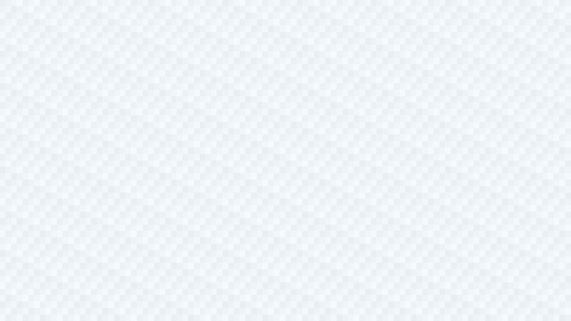

The scrim has to hold this sentence against an almost white picture, all the way across.

<Media>

</Media>

<Caption>Larkfield, January 2026. Photo: the parks team, used with permission.</Caption>

<Notes>Probe: text bottom over the snow photo.</Notes>
