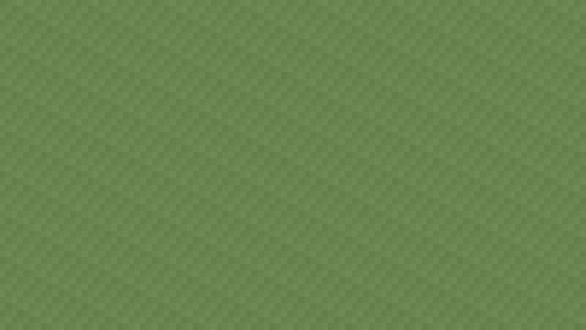

Westgate, July 2026. Pattern: MIT.

<Notes>Probe: the old image layout's caption, a dark slate over a midtone test pattern where the old scrim had faded out, rebuilt with plain markup. deckster lint must report its contrast.</Notes>
