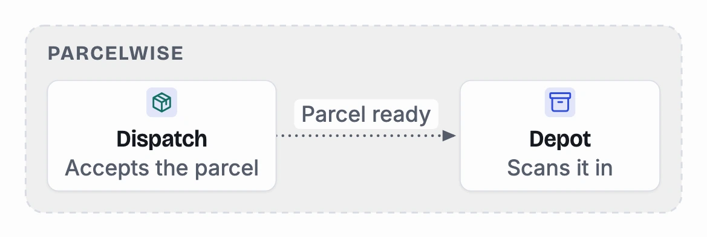

Set a brand's diagram defaults in `brand.ts` and override them where a slide calls for a different drawing. Use these controls to place a compact diagram, size its nodes, change connector strokes and add a local or remote image icon.

<Aside type="note" title="New in v0.8.0">
  Diagram design controls are available in `@deckster/cli` 0.8.0.
</Aside>

## Override one drawing

In a [`diagram` layout](/reference/layouts/diagram/), place the drawing with `align="left"`, `align="center"` or `align="right"`. Alignment places the whole drawing within its region when space allows. Grid cells and `direction` still determine where nodes go within the drawing. Leave `align` out to use the brand's alignment or the diagram's usual layout.

The dispatch handoff places two nodes on the right. Their boxes have preferred widths of 252 and 220 canvas pixels. The first node has a minimum height of 120. A dashed line encloses the group and a dotted connector marks the handoff.



```mdx
import parcelMark from '../assets/parcel-mark.svg?url&no-inline';

<Flow title="Dispatch hands accepted parcels to the depot" align="right">
  <Group label="Parcelwise" lineStyle="dashed" strokeWidth={2}>
    <Node id="dispatch" icon={parcelMark} title="Dispatch" subtitle="Accepts the parcel" width={252} height={120} col={1} row={1} />
    <Node id="depot" kind="storage" title="Depot" subtitle="Scans it in" width={220} col={2} row={1} />
  </Group>
  <Edge from="dispatch" to="depot" label="Parcel ready" lineStyle="dotted" strokeWidth={3} />
</Flow>
```

[Dispatch handoff slide source](https://github.com/sandrinodm/deckster/blob/be8cc95edb8db522f084f7f8b3a89ef46e9efd5b/decks/diagrams-demo/slides/dispatch-handoff.mdx)

The layout can narrow a node to fit its region and grow its height to fit the text. Connectors and group outlines take a `strokeWidth` from 0 to 64 canvas pixels and a `lineStyle` of `solid`, `dashed` or `dotted`. Zero hides the stroke.

An explicit width or pattern wins over the brand default. A flow edge marked `dashed` or `async`, a sequence message marked `reply` or `async`, and an edge in the error state still draw dashed. States still apply their own colours. For a group's brand default, `groups.lineStyle` takes precedence over the older `groups.dashed` setting.

## Set defaults in a brand

Add a `diagram` section to [your brand](/brands/create-a-brand/). This example gives diagrams a centered layout with dotted connectors and gives the `default` card a bordered icon tile.

```ts
diagram: {
  align: 'center',
  edges: { stroke: 3.5, lineStyle: 'dotted' },
  groups: { stroke: 'hairline', lineStyle: 'dashed' },
  nodes: {
    width: 224,
    height: 96,
    subtitle: { type: 'small', family: 'mono', weight: 500 },
  },
  notes: { type: 'caption', family: 'body', weight: 450 },
  cards: {
    default: {
      icon: { style: 'chip', border: 'accent', borderWidth: 2, borderStyle: 'solid' },
    },
  },
},
```

- Set edge, group or icon border widths in canvas pixels or name a width from `shape.stroke` (`hairline`, `regular` or `bold`). A group also accepts `stroke: 'none'`. For node dimensions, zero or omission lets the layout use its own sizing.
- Choose `caption`, `label`, `small` or `body` for the base typography step. Subtitles accept the step name alone or an object with `type`, `family`, `weight`, `tracking` and `case`. Give `notes` the object form. `family` names `display`, `body` or `mono`. Weight runs from 1 to 1000 and tracking runs from −0.1 to 0.5 em. Set `case` to `'upper'` or `'none'`.
- A card's `subtitle` overrides the same properties on `diagram.nodes.subtitle` and inherits any subtitle properties on `diagram.cards.default`. Set `subtitle: null` on a card to use the diagram-wide settings directly. An unspecified property falls back to the selected typography step. `diagram.notes` styles the detail under a timeline milestone. The slide's `<Notes>` holds speaker notes separately.
- Set `borderStyle` on a card for a solid, dashed or dotted node outline. Cards inherit this setting from `diagram.cards.default`. Set `icon.border`, `icon.borderWidth` and `icon.borderStyle` on the card for its icon tile. The tile uses the card's detail colour when you set a width and leave its border colour out. Use `icon.borderWidth: 0` to remove a tile outline. To change only the icon border colour on one surface, put `icon: { border: '…' }` under `color.surfaces.<name>.diagram.cards.<card>`.

Run `deckster brand check <name>` to validate the brand, and `deckster brand <name>` to read the resolved diagram defaults.

## Where the controls apply

| Diagram | Placement | Strokes | Size and supporting type | Image icons |
| --- | --- | --- | --- | --- |
| `<Flow>` | `align` | `<Edge>` connector and `<Group>` outline | `<Node>` width, height and subtitle | `<Node>` |
| `<Cycle>` | `align` | `<Edge>` for the arc between adjacent stages | `<Node>` width, height and subtitle | `<Node>` |
| `<Tree>` | `align` | Brand edge width and pattern for branches | `<Node>` width, height and subtitle | `<Node>` |
| `<SequenceDiagram>` | `align` | `<Message>` connector | `<Actor>` width, height and subtitle | `<Actor>` |
| `<Layers>` | `align` | Card outlines for items and bands with a card | `<Layer>` subtitle | `<Item>` |
| `<Timeline>` | `align` | Brand edge pattern and numeric edge width style the track | `<Milestone>` detail text uses `diagram.notes` | `<Milestone>` |
| `<Svg>` | Authored in the SVG | Authored in the SVG | Authored in the SVG | Authored in the SVG |

Node cards apply to flow, cycle and tree nodes, sequence actors and layer items. An explicit card on a layer styles its band. Timeline milestones use their own icon treatment. A named edge stroke width keeps the timeline track at the brand's regular stroke. See [how a node picks its card](/data-and-diagrams/flow-diagrams/#pick-a-card).

## Bundle an image icon

Save an SVG, PNG, JPEG, GIF, WebP or AVIF in your deck and write its path relative to the slide in MDX. Deckster bundles the file. A `?url` import also works in MDX or TSX. Add `&no-inline` to emit a separate asset, as in the dispatch example. An image keeps its own colours. Add a title to convey the meaning of the node or part.

```mdx
<Node id="dispatch" title="Dispatch" icon="../assets/parcel-mark.svg" />
```

You can also give `icon` an HTTPS image URL, such as `icon="https://cdn.example.com/parcel-mark.svg"`. The browser loads it when it renders the deck, so the URL has to work from the presentation or export environment. Use a bundled file for offline decks. MDX still accepts Iconify icon names such as `package`, and `icon="none"` hides an icon.

In native and hybrid PowerPoint exports, node shapes and icon borders remain editable. For a line that follows its nodes when you move them, use a flow edge with a straight or supported right-angle route whose endpoints meet the nodes. Curved or complex routes export as freeform lines, and paths inside imported SVG artwork carry no node attachments. Check the dry run for simplified routes and move a node in the exported slide to confirm the connection. [PowerPoint export](/export-and-publish/powerpoint/)

Image icons are embedded as pictures. If an original cannot be embedded, the exporter uses a PNG of the browser rendering where available. The browser has to be able to load the icon for that rendering.
