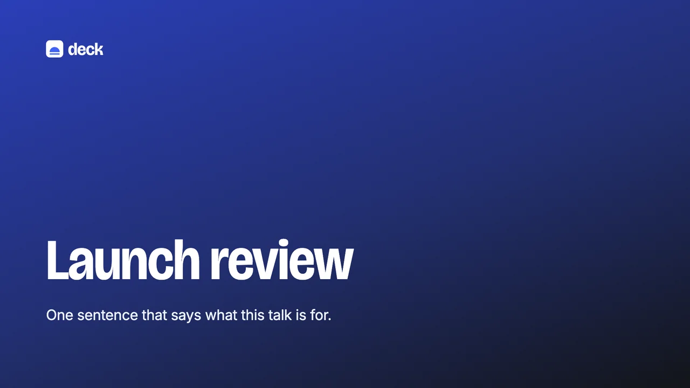

In six steps you install the `deckster` CLI, create a workspace with one deck, open it in the browser with hot reload, install the browser the checks use, and check the deck with `deckster lint`. You need Node.js 26 or later.

## Create and open a deck

<Steps>

1. Install the CLI from npm:

   ```sh
   npm install --global @deckster/cli
   ```

   npm prints two `npm warn ERESOLVE overriding peer dependency` warnings about `vite`, from `@tailwindcss/vite` and `@vitejs/plugin-react`: the CLI bundles its own Vite build, and the install succeeds. `pnpm add --global @deckster/cli` works too. Check the version:

   ```console
   $ deckster --version
   0.11.0
   ```

2. Make a folder for your talks and go into it:

   ```sh
   mkdir talks && cd talks
   ```

   This folder is your workspace. The CLI works in the nearest folder at or above the current one that has a `decks/` folder, and in the current folder when there is none, so make the folder first. From your home folder or `/`, a command such as `deckster dev` stops with this message instead:

   ```text
   /Users/you is a home or root folder, so deck will not use it as a workspace: a deck's dev server would sit next to your keys and tokens.
   Make a project folder (`mkdir talks && cd talks`) and run the command there, or set DECK_ROOT to the folder you mean.
   ```

3. Create a deck with a title and a talk length:

   ```console
   $ deckster new launch-review --title "Launch review" --duration 20m
   decks/launch-review/deck.config.ts
   decks/launch-review/slides/title.mdx
   Next: run `deckster dev launch-review`. For editor type checking, run `deckster types` once (again after upgrading @deckster/cli).
   ```

   Deck names are kebab-case. The title must fit the `title` layout, which allows 36 characters. If you try a longer title, the command refuses it and suggests a shorter one:

   ```console
   $ deckster new board-update --title "A very long title that goes on and on and on and on and on and on and on and on"
   --title is 79 characters, but the title layout allows a title of at most 36. Shorten it, for example to "A very long title that goes on and o".
   Run `deckster new --help` for the usage.
   ```

4. Serve it:

   ```console
   $ deckster dev launch-review
     ➜  Local:   http://127.0.0.1:5173/
     ➜  press h + enter to show help
   ```

   Open the URL. Your new deck uses the CLI's `default` brand, as shown here. The [example gallery](/examples/choose-a-deck/) uses Fieldnote.

   

   The server takes the first free port from 5173 (`--port <n>` picks one and fails if it is taken) and reloads the slide when you save a file. The first run can also print a line about Vite optimizing dependencies. Type `q` and press Enter, or press Ctrl+C, to stop it.

5. Install Chromium once. `deckster lint`, `deckster shot`, `deckster diff` and `deckster export` render the deck in Playwright's Chromium, and without it they stop with the command to run (the path is cut here):

   ```console
   $ deckster lint launch-review
   Could not start Chromium: browserType.launch: Executable doesn't exist at ...
   Install the browser with `npx playwright@1.65.1 install chromium`.
   ```

   Run that command:

   ```sh
   npx playwright@1.65.1 install chromium
   ```

   Outside a project that depends on Playwright, it first prints a warning box suggesting `npm install`; the download goes ahead anyway. It fetches Chrome for Testing, FFmpeg and Chrome Headless Shell into Playwright's own cache, once per machine.

6. Check the deck:

   ```console
   $ deckster lint launch-review
   launch-review: no problems in 1 slide (1 step checked).
   ```

7. To present in a window of its own with `deckster present`, download Electron once (about 120 MB). npm usually skips this download when it installs the CLI:

   ```sh
   deckster electron install
   ```

   Skip it if you present in a browser: `deckster present launch-review --browser` uses Chrome. See [`deckster present` and displays](/present/deck-present-and-displays/).

</Steps>

To work with several decks from the same folder, see [how `deckster dev` picks a deck](/get-started/workspace-layout/#how-deck-dev-picks-a-deck).

## What `deckster new` wrote

Two files, and nothing else: no `package.json`, no `node_modules` to install.

<FileTree>
- talks/
  - decks/
    - launch-review/
      - deck.config.ts
      - slides/
        - title.mdx
</FileTree>

`deck.config.ts` names the deck's title, its brand, the talk length and the slides in order:

```ts
import { defineDeck } from '@deckster/engine/config';

export default defineDeck({
  title: 'Launch review',
  brand: 'default',
  duration: '20m',
  slides: ['title'],
});
```

`slides/title.mdx` is the first slide, made from the `title` layout's example. The frontmatter picks the layout, the body is the subtitle, and `<Notes>` holds what you say:

```mdx
---
layout: title
title: Launch review
---

One sentence that says what this talk is for.

<Notes>
Say what the audience should do or believe when the talk ends.
</Notes>
```

`--brand <name>` on `deckster new` writes another brand folder name instead of `default`. Only `default` ships with the CLI; [Use a brand](/brands/use-a-brand/) shows how to add others. Once you run commands, the workspace also gets a `.deck/` folder for screenshots and exports; [Workspace layout](/get-started/workspace-layout/) explains each folder.

## Type checking in your editor

Optional. Run `deckster types` once in the workspace so your editor and `tsc` resolve the `@deckster/*` imports in `deck.config.ts` and TSX slides:

```console
$ deckster types
tsconfig.json
.deck/env.d.ts
Mapped 71 @deckster/* entry points. The paths name this install: run `deckster types` again after upgrading @deckster/cli.
```

The paths it writes point into your global install, so run it again after upgrading the CLI, and do not commit `tsconfig.json` to a repository that others install differently.

## Next

[Your first deck](/get-started/your-first-deck/) adds slides, builds, speaker notes and an export to this deck. To let an agent write the next one, install the [skills](/ai-agents/skills/). Every command and flag is in the [CLI reference](/reference/cli/).
